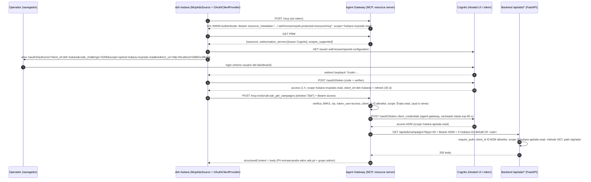

# Hubara Agent Gateway — informe de investigación y propuesta de auth

> Fecha: 2026-10-14 · Estado: **propuesta, pendiente de decisiones del operador** (§6)
> Marcas: **[V]** verificado en la fuente primaria · **[E]** verificado empíricamente hoy · **[I]** inferencia.

## 1. Especificación MCP vigente

- La versión *current* es **2026-07-28** [V] https://modelcontextprotocol.io/specification/versioning.
  Respecto de 2025-11-25 ([V] https://modelcontextprotocol.io/specification/2026-07-28/changelog):
  - desaparecen las sesiones (`Mcp-Session-Id`) y el handshake `initialize`;
  - la versión y las capacidades viajan en `_meta`;
  - DCR queda **deprecado**;
  - se agrega la validación de `iss` (RFC 9207).
- **El cliente que nos importa habla 2025-11-25.** `@modelcontextprotocol/sdk` 1.32.1 (el que usa
  `@acktos/dsh-hubara`) declara `LATEST_PROTOCOL_VERSION = '2025-11-25'` [E] (en
  `node_modules/@modelcontextprotocol/sdk/dist/esm/types.js:2` del plugin). El server tiene que aceptar
  esa era, con `initialize`; el SDK Python 2.x soporta ambas eras [V]
  https://py.sdk.modelcontextprotocol.io/migration/. La compatibilidad se prueba de punta a punta en
  el test e2e con el cliente TS real.

### 1.1 Authorization ([V] https://modelcontextprotocol.io/specification/2026-07-28/basic/authorization)

- **Rol.** El MCP server es un *OAuth 2.1 resource server*. MUST implementar Protected Resource Metadata
  (RFC 9728, [V] https://datatracker.ietf.org/doc/html/rfc9728):
  - campos `resource` (REQUIRED, idéntico al identificador) y `authorization_servers` (MUST ≥ 1);
  - `scopes_supported` es RECOMMENDED.
- **Descubrimiento.** El server MUST publicar `resource_metadata` en el `WWW-Authenticate` del 401 o el
  well-known (con path: `/.well-known/oauth-protected-resource/mcp`) [V]
  https://modelcontextprotocol.io/specification/2026-07-28/basic/authorization/authorization-server-discovery.
- **Scopes en el challenge.**
  - El 401 SHOULD llevar `scope=`.
  - Ante scope insuficiente, el server SHOULD responder `403` con `error="insufficient_scope"`, el `scope`
    y `resource_metadata`.
  - El cliente acumula la unión de scopes (step-up).
- **Audiencia (RFC 8707).**
  - El cliente MUST mandar `resource` en *authorize* y en *token*.
  - El server MUST validar que el token fue emitido **para él** (audiencia).
- **Prohibición de token passthrough.**
  - "MCP servers **MUST NOT** accept any tokens that were not explicitly issued for the MCP server." [V]
    https://modelcontextprotocol.io/docs/2026-07-28/tutorials/security/security_best_practices
  - "The MCP server MUST NOT pass through the token it received from the MCP client." [V]
    https://modelcontextprotocol.io/specification/2026-07-28/basic/authorization/security-considerations
  - El token hacia el backend es **otro token**, emitido para el backend (misma fuente).
- **Registro de clientes** ([V] https://modelcontextprotocol.io/specification/2026-07-28/basic/authorization/client-registration).
  CIMD es SHOULD; DCR es MAY y está deprecado; los clientes SHOULD soportar **pre-registro**.
  Orden en el cliente:
  1. pre-registrado;
  2. CIMD;
  3. DCR;
  4. preguntar al usuario.
- **PKCE.** Si el metadata del AS no trae `code_challenge_methods_supported`, un cliente estricto
  **MUST negarse** [V] (security-considerations).

### 1.2 Transporte y tools

- **Streamable HTTP** ([V] https://modelcontextprotocol.io/specification/2026-07-28/basic/transports/streamable-http):
  - el server MUST validar `Origin` (si es inválido, 403);
  - SHOULD hacer bind a 127.0.0.1 en local;
  - SHOULD autenticar todas las conexiones.
- **Modo stateless.**
  - En el SDK Python: `stateless_http=True`, `json_response=True`.
  - Protección DNS-rebinding con `TransportSecuritySettings(allowed_hosts, allowed_origins)`. Se
    **autoactiva solo para localhost**; con un hostname real hay que configurarla [V]
    https://github.com/modelcontextprotocol/python-sdk/blob/main/src/mcp/server/transport_security.py.
- **Tools** ([V] https://modelcontextprotocol.io/specification/2026-07-28/server/tools):
  - con `outputSchema`, `structuredContent` MUST conformar;
  - el server SHOULD repetir el JSON en un `TextContent`;
  - los errores de dominio o de API van como `isError: true`.
- **Annotations.** `readOnlyHint` etc. son *hints* no confiables [V] (schema 2026-07-28). El solo-lectura
  se impone en el server (no hay tools de escritura y el backend solo recibe GET) y en el backend
  (scope `ads.read` acotado a GET).

## 2. SDK elegido: `mcp` 2.3.0 (Python oficial)

- `mcp` **2.3.0** (2026-10-02) es el SDK oficial [E] https://pypi.org/pypi/mcp/json. En v2,
  `FastMCP` pasó a llamarse **`MCPServer`** (`mcp.server.mcpserver`); `mcp.server.fastmcp` lanza
  `ModuleNotFoundError` [E] (código instalado).
- `fastmcp` 4.1.0 (PrefectHQ) **no** es el oficial. Trae un `OAuthProxy` para Cognito que emula DCR [V]
  https://gofastmcp.com/v3/integrations/aws-cognito, pero no lo necesitamos: el plugin usa un cliente
  pre-registrado.
- **Por qué Python y no TypeScript.**
  - El backend, el equipo, los gates y el tooling del repo son Python.
  - Los contratos `/api/ads/*` se verifican contra los fixtures con pytest.
  - El SDK Python ya trae la mitad *resource server*: `TokenVerifier`, `AuthSettings`, la ruta PRM y el
    `RequireAuthMiddleware`.
  - El SDK TS (`@modelcontextprotocol/server` 2.3.1) es el cliente más completo, y por eso **se queda
    del lado del plugin**, que ya lo usa.
- **Brechas del SDK Python que cubrimos nosotros** (código 2.3.0 [V]):
  - el challenge 401/403 **no incluye `scope=`**;
  - `validate_token_resource` está en False por defecto (pasa a True en 3.0);
  - el verificador JWT de Cognito no existe y hay que escribirlo.
- **Uso: `Server` de bajo nivel, no `MCPServer`.** Las 11 tools son data-driven (catálogo → ruta GET).
  Necesitamos controlar `structuredContent`, `outputSchema` e `isError` exactamente. `MCPServer` valida
  y reescribe la salida según el tipo de retorno de la función; con `Server` (`on_list_tools` /
  `on_call_tool`) el contrato queda en nuestras manos.

## 3. Cognito — qué hay y qué falta

Estado real del pool de prod `agencyhubara-hubara`, consultado en solo lectura [E]:

| Ítem | Valor |
|---|---|
| Tier | **ESSENTIALS**: Pre Token Generation V2/V3 disponible, managed login disponible |
| Dominio | `agencyhubara-hubara`, **ManagedLoginVersion 1** (Hosted UI clásica) |
| Resource servers | **ninguno** |
| App clients | solo `dashboard-hubara` (público, `code`, scopes `openid email profile`) |
| Lambda triggers | ninguno |

Capacidades relevantes:

- **Resource binding (RFC 8707): existe desde 2025-10-24** [V]
  https://docs.aws.amazon.com/cognito/latest/developerguide/cognito-user-pools-define-resource-servers.html.
  Con `resource=` en `/oauth2/authorize`, el access token lleva `aud` = ese recurso.
  - Límites: un solo `resource` por request; **solo managed login** (code/implicit); **no en
    client_credentials**; el refresh conserva `aud`.
  - Nuestro dominio está en la versión 1 (clásico): usarlo implica migrar el dominio a managed login
    (v2), y eso cambia la pantalla de login del dashboard.
  - `/oauth2/token` **no documenta** `resource` [V]
    https://docs.aws.amazon.com/cognito/latest/developerguide/token-endpoint.html. Si lo rechaza, el
    plugin puede omitirlo: en el SDK TS, `validateResourceURL()` devuelve `undefined` [I, verificar en
    el spike].
- **Custom scopes.**
  - Formato `<resource-server-id>/<scope>`, en el claim `scope` separado por espacios [V]
    https://docs.aws.amazon.com/cognito/latest/developerguide/amazon-cognito-user-pools-using-the-access-token.html.
  - En un access token **de usuario**, un custom scope aparece si el app client lo tiene permitido y el
    cliente lo pide en *authorize*. **No hace falta** Pre Token Generation para eso [V] (define-resource-servers).
- **M2M (client_credentials).**
  - Requiere secret y emite solo custom scopes [V] (define-resource-servers).
  - Cuesta **$0.00225 por token request** exitoso [V] https://aws.amazon.com/cognito/pricing/. Con caché
    hasta `exp`, son unas 24 emisiones al día (≈ USD 1.6/mes).
- **Pre Token Generation V2/V3.** V2 agrega o suprime scopes en tokens de usuario; V3 cubre también M2M
  y recibe `aws_client_metadata` (permite *on-behalf-of*) [V]
  https://docs.aws.amazon.com/cognito/latest/developerguide/user-pool-lambda-pre-token-generation.html.
- **Sin DCR ni CIMD** ("Amazon Cognito does not support Dynamic Client Registration (RFC 7591)") [V]
  https://docs.aws.amazon.com/bedrock-agentcore/latest/devguide/runtime-oauth.html. AWS lo resuelve con un
  **cliente pre-registrado con puerto de callback fijo**: Cognito no admite rangos de puertos [V]
  https://docs.aws.amazon.com/bedrock-agentcore/latest/devguide/registry-mcp-endpoint.html y
  https://aws.amazon.com/blogs/machine-learning/building-a-secure-auth-code-flow-setup-using-agentcore-gateway-with-mcp-clients/.
- **Sin token exchange.** El token endpoint solo acepta `authorization_code`, `refresh_token` y
  `client_credentials`, así que **no hay RFC 8693** [V] (token-endpoint).
- **Metadata del AS.**
  - `…/<pool>/.well-known/openid-configuration` responde 200; las variantes RFC 8414 responden 400 [E].
  - No publica `code_challenge_methods_supported` [E]: un cliente **estricto** 2026-07-28 rechazaría
    Cognito.
  - El SDK TS (el del plugin) solo aborta si el campo existe **y** no incluye S256, así que con Cognito
    **sigue adelante** [V]
    https://github.com/modelcontextprotocol/typescript-sdk/blob/main/packages/client/src/client/auth.ts.
- **Validación JWT** ([V] https://docs.aws.amazon.com/cognito/latest/developerguide/amazon-cognito-user-pools-using-tokens-verifying-a-jwt.html):
  - firma RS256 contra el JWKS (por `kid`);
  - `exp`, `iss` y `token_use=access`;
  - el access token trae `client_id` y **no trae `aud`** salvo con resource binding.
- **Backend hoy** (`hubara_agency/src/platform/auth.py:82-103`) exige `client_id == COGNITO_APP_CLIENT_ID`
  (dashboard) y no mira `scope`. Un token M2M recibe **401** [E] (lectura del código).

## 4. Propuesta (recomendada)

### 4.1 Piezas en Cognito (Terraform, módulo `auth`; nada se aplica sin OK)

| Recurso | Tipo | Detalle |
|---|---|---|
| Resource server `hubara-mcp` | scopes | `ads.read` (todas las tools), `ads.pii` (ver PII sin enmascarar; solo grupo `admin`) — reservado `ads.write` (fase escrituras) |
| Resource server `hubara-api` | scopes | `ads.read` (GET `/api/ads/*` en el backend) |
| App client `dsh-hubara-<tenant>` | **público**, `code` + PKCE | callback `http://localhost:53682/callback` (puerto fijo), scopes `openid hubara-mcp/ads.read hubara-mcp/ads.pii`, access 1 h, refresh 30 d |
| App client `agent-gateway-<tenant>` | **confidencial**, `client_credentials` | scope `hubara-api/ads.read`. Secret en SSM, al contenedor por env, nunca en la imagen |
| (opcional) `dsh-hubara-headless-<tenant>` | confidencial, `client_credentials` | scope `hubara-mcp/ads.read`, para un DSH desatendido. Nunca PII |

### 4.2 Flujo

### 4.3 Validación en el gateway (entrada)

- Firma RS256 contra el JWKS del pool (cacheado y rotado por `kid`), `exp` e `iss`.
- `token_use == "access"`: un ID token se rechaza.
- **Audiencia.** `client_id ∈ GATEWAY_ALLOWED_CLIENT_IDS`. Si el token trae `aud`, MUST ser igual a
  `GATEWAY_RESOURCE_URL`.
  - Hoy es audiencia por cliente: solo `dsh-hubara` (y el headless) pueden obtener `hubara-mcp/*`, así
    que un token del dashboard **no** sirve en el gateway y un token del gateway **no** sirve en el
    backend (`client_id` distinto).
  - Con managed login v2 se pasa a `aud` estricto con un flag (§6, decisión 3).
- **Scope.** `hubara-mcp/ads.read` para todo.
  - Sin token o con token inválido: **401** con `WWW-Authenticate: Bearer resource_metadata="…",
    scope="hubara-mcp/ads.read"` (middleware propio, porque el del SDK omite `scope`).
  - Token válido sin scope: **403** `error="insufficient_scope"`.
- **PII.** Se ve sin enmascarar solo con scope `hubara-mcp/ads.pii` **y** `cognito:groups ∋ admin` (el
  claim viene en el access token). Sin Lambda.
- **Nunca** se acepta `HUBARA_SERVICE_TOKEN`: el gateway ni siquiera lo conoce.

### 4.4 Salida hacia el backend (sin token passthrough)

- **Recomendado: un M2M propio del gateway más un cambio mínimo en el backend** (con ADR):
  - `require_auth` acepta además access tokens con `client_id ∈ COGNITO_M2M_CLIENT_IDS`, **solo si**
    `scope ∋ hubara-api/ads.read` **y** el request es `GET` bajo `/api/ads/`. Cualquier otra cosa
    responde 403;
  - el actor queda `m2m:<client_id>`;
  - la identidad del usuario viaja en `X-Hubara-On-Behalf-Of` **solo para auditoría**, nunca para
    autorizar (igual que hoy `x-hubara-id-token`);
  - el token del usuario **nunca** sale del gateway.
- **Alternativa: on-behalf-of con Pre Token Generation V3.** El gateway pide un M2M con
  `aws_client_metadata={user_token}` y una Lambda valida el token del usuario y estampa `on_behalf_of`.
  - Ventaja: atribución criptográfica.
  - Costos: una Lambda más, latencia y un punto de falla. Además hay que pedir un token por usuario y
    por hora.
  - Fase 2 si la auditoría lo exige.
- **Descartadas:**
  - `HUBARA_SERVICE_TOKEN`: es un token "dios" sin scopes;
  - passthrough: lo prohíbe la spec;
  - RFC 8693: Cognito no lo tiene;
  - gateway in-process en la API: el pedido es un servicio aparte y aislado.

### 4.5 Riesgos y mitigación

| Riesgo | Mitigación |
|---|---|
| Un cliente MCP estricto (no el nuestro) rechaza Cognito por faltar `code_challenge_methods_supported` | Fase 2: fachada de metadata RFC 8414 en el gateway. Hoy el único cliente es el TS SDK, que es laxo [V] |
| `/oauth2/token` de la Hosted UI clásica rechaza `resource` | El plugin omite `resource` con `validateResourceURL` → `undefined` (handoff). Validar en el spike de login |
| Sin `aud` (dominio v1) la audiencia es por `client_id` + scope, más débil que lo que pide la spec | Scopes exclusivos por cliente. Migrar a managed login v2 y activar `aud` estricto con un flag |
| Callback de puerto fijo ocupado | Puerto configurable en el plugin; Terraform registra 1–2 puertos |
| El cambio en `require_auth` amplía la superficie del backend | Allowlist explícita, scope exigido, solo GET y solo `/api/ads/`; tests negativos primero (TDD) |

## 5. Escrituras (fase posterior, solo diseño)

- Scope `hubara-mcp/ads.write`, más grupo `admin` en el gateway, más `hubara-api/ads.write` M2M en el
  backend acotado a las 3 rutas POST.
- Doble aprobación humana:
  1. el gateway devuelve primero un *plan* (`InputRequiredResult` / elicitation, en 2026-07-28), sin
     ejecutar;
  2. `tools/pre-execute` en DSH bloquea `mcp__hubara__ads_*` de escritura (ya figuran en
     `WRITE_TOOLS_DEFAULT`).
- Idempotency-Key obligatorio. Fuera de esta entrega.

## 6. Decisiones para el operador

Ver el mensaje de la sesión (se preguntan antes de implementar la auth).
